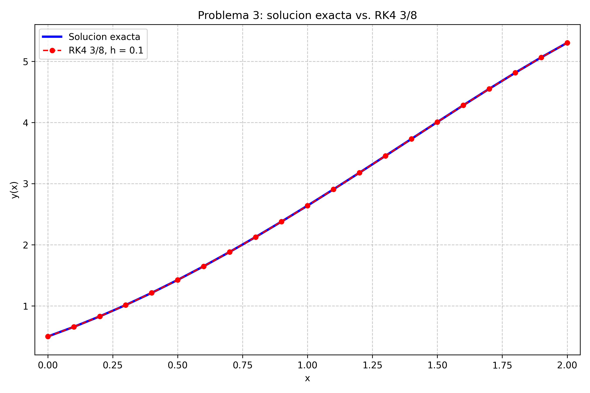

# Problema 3 — Segundo Parcial 2025 (Ecuaciones diferenciales ordinarias)

Resolución completa del problema, con el desarrollo manual paso a paso, la
verificación con `problema3.c++` y la gráfica comparativa.

## Archivos de esta carpeta

| Archivo | Qué es |
|---|---|
| `problema3.c++` | Programa: Euler y punto medio para el primer paso, RK4 3/8 con \(h=0.1\), errores y generación del CSV. |
| `problema3` | Ejecutable ya compilado. |
| `resultados_rk4.csv` | Tabla `x, y_numerica, y_exacta, error` para las 20 iteraciones. |
| `grafico_problema3.py` | Script que genera la gráfica comparativa. |
| `grafico_rk4.png` | Gráfica de la solución exacta y la aproximación RK4 3/8. |
| `salida_problema3.txt` | Salida completa del programa, útil para la captura de consola. |
| `captura_problema3.png` | Captura tipo consola de la salida del programa. |
| `README - Problema 3.md` | Este documento. |

Compilar y ejecutar:

```bash
g++ -Wall -Wextra -O2 -o problema3 problema3.c++ -lm
./problema3
python3 grafico_problema3.py
```

---

## Enunciado

Resolver la ecuación diferencial ordinaria

\[
\frac{dy}{dx}=y-x^2+1,
\]

con condición inicial

\[
y(0)=0.5,
\]

en el intervalo

\[
x\in[0,2].
\]

La solución exacta dada es

\[
y(x)=(x+1)^2-0.5e^x.
\]

**a)** Resolver a mano el primer paso con \(h=0.2\) usando:

- método de Euler,
- método del punto medio.

Calcular el error absoluto exacto en cada caso.

**b)** Usar el método de **Runge-Kutta de cuarto orden 3/8** con \(h=0.1\).
Informar los valores de \(y(1.5)\) e \(y(2.0)\) con 10 cifras decimales y sus
errores absolutos exactos, mostrando el procedimiento paso a paso.

**c)** Graficar la solución exacta junto con la solución aproximada.

---

## Verificación de la solución exacta

\[
y(x)=(x+1)^2-0.5e^x.
\]

En \(x=0\):

\[
y(0)=(0+1)^2-0.5e^0=1-0.5=0.5.
\]

La condición inicial se cumple.

Derivando:

\[
y'(x)=2(x+1)-0.5e^x.
\]

Por otro lado:

\[
y-x^2+1=(x+1)^2-0.5e^x-x^2+1
\]

\[
=x^2+2x+1-0.5e^x-x^2+1
\]

\[
=2x+2-0.5e^x=2(x+1)-0.5e^x.
\]

Por lo tanto, la solución exacta satisface la EDO.

---

## Inciso a) Primer paso con \(h=0.2\)

### Datos

\[
x_0=0,\qquad y_0=0.5,\qquad h=0.2.
\]

La función de la EDO es

\[
f(x,y)=y-x^2+1.
\]

### Método de Euler

La fórmula es

\[
y_{i+1}=y_i+h f(x_i,y_i).
\]

Para el primer paso:

\[
k_1=f(x_0,y_0)=f(0,0.5)=0.5-0^2+1=1.5.
\]

\[
y_1=y_0+h k_1=0.5+0.2(1.5).
\]

\[
\boxed{y_1=0.8000000000}
\]

La solución exacta en \(x=0.2\) es

\[
y(0.2)=(0.2+1)^2-0.5e^{0.2}.
\]

\[
y(0.2)=1.44-0.5(1.2214027582)
\]

\[
y(0.2)=1.44-0.6107013791=0.8292986209.
\]

Error absoluto:

\[
E_{\text{Euler}}=\left|0.8000000000-0.8292986209\right|
\]

\[
\boxed{E_{\text{Euler}}=0.0292986209}
\]

Con 6 cifras decimales:

\[
\boxed{y_1^{\text{Euler}}\approx 0.800000,\qquad
E_{\text{Euler}}\approx 0.029299}
\]

### Método del punto medio

El método del punto medio es

\[
y_{i+1/2}=y_i+\frac{h}{2}f(x_i,y_i),
\]

\[
y_{i+1}=y_i+h f(x_{i+1/2},y_{i+1/2}).
\]

Primero:

\[
k_1=f(0,0.5)=1.5.
\]

Punto medio:

\[
x_{1/2}=x_0+\frac{h}{2}=0+0.1=0.1,
\]

\[
y_{1/2}=y_0+\frac{h}{2}k_1=0.5+0.1(1.5)=0.65.
\]

Segunda pendiente:

\[
k_2=f(0.1,0.65)=0.65-(0.1)^2+1.
\]

\[
k_2=0.65-0.01+1=1.64.
\]

Actualización:

\[
y_1=y_0+h k_2=0.5+0.2(1.64).
\]

\[
\boxed{y_1=0.8280000000}
\]

Error absoluto:

\[
E_{\text{PM}}=\left|0.8280000000-0.8292986209\right|
\]

\[
\boxed{E_{\text{PM}}=0.0012986209}
\]

Con 6 cifras decimales:

\[
\boxed{y_1^{\text{PM}}\approx 0.828000,\qquad
E_{\text{PM}}\approx 0.001299}
\]

### Comparación del primer paso

| Método | \(y(0.2)\) aproximada | \(y(0.2)\) exacta | Error absoluto |
|---|---:|---:|---:|
| Euler | 0.8000000000 | 0.8292986209 | 0.0292986209 |
| Punto medio | 0.8280000000 | 0.8292986209 | 0.0012986209 |

El punto medio mejora notablemente a Euler porque evalúa la pendiente en el
punto medio del intervalo.

---

## Inciso b) RK4 3/8 con \(h=0.1\)

### Fórmulas del método

Para el método de Runge-Kutta de cuarto orden 3/8:

\[
k_1=f(x_i,y_i),
\]

\[
k_2=f\left(x_i+\frac{h}{3},\ y_i+\frac{h}{3}k_1\right),
\]

\[
k_3=f\left(x_i+\frac{2h}{3},\ y_i-\frac{h}{3}k_1+h k_2\right),
\]

\[
k_4=f\left(x_i+h,\ y_i+h k_1-h k_2+h k_3\right),
\]

\[
y_{i+1}=y_i+\frac{h}{8}\left(k_1+3k_2+3k_3+k_4\right).
\]

Como \(h=0.1\):

\[
\frac{h}{3}=0.0333333333,\qquad
\frac{2h}{3}=0.0666666667,
\]

\[
\frac{h}{8}=0.0125.
\]

### Primer paso, de \(x=0\) a \(x=0.1\)

\[
x_0=0,\qquad y_0=0.5.
\]

**Pendiente 1:**

\[
k_1=f(0,0.5)=1.5.
\]

**Pendiente 2:**

\[
x_0+\frac{h}{3}=0.0333333333,
\]

\[
y_0+\frac{h}{3}k_1=0.5+0.0333333333(1.5)=0.55,
\]

\[
k_2=f(0.0333333333,0.55)
=0.55-0.0333333333^2+1
=1.5488888889.
\]

**Pendiente 3:**

\[
x_0+\frac{2h}{3}=0.0666666667,
\]

\[
y_0-\frac{h}{3}k_1+h k_2
=0.5-0.05+0.1548888889
=0.6048888889,
\]

\[
k_3=f(0.0666666667,0.6048888889)
=1.6004444444.
\]

**Pendiente 4:**

\[
x_0+h=0.1,
\]

\[
y_0+h k_1-h k_2+h k_3
=0.5+0.15-0.1548888889+0.1600444444
=0.6551555556,
\]

\[
k_4=f(0.1,0.6551555556)
=1.6451555556.
\]

**Actualización:**

\[
y_1=0.5+\frac{0.1}{8}
\left(1.5+3(1.5488888889)+3(1.6004444444)+1.6451555556\right)
\]

\[
y_1=0.5+0.0125(11.5925555556)
\]

\[
\boxed{y_1=0.6574144444}
\]

La solución exacta es

\[
y(0.1)=(1.1)^2-0.5e^{0.1}
=1.21-0.5525854590
=0.6574145410.
\]

La diferencia con la aproximación es del orden de \(10^{-7}\).

### Pasos pedidos: \(y(1.5)\) e \(y(2.0)\)

Los valores que se obtienen al aplicar el método hasta \(x=1.5\) y \(x=2.0\)
son:

\[
\boxed{y(1.5)\approx 4.0091534443}
\]

\[
\boxed{y(2.0)\approx 5.3054691789}
\]

Los valores exactos son:

\[
y(1.5)=(2.5)^2-0.5e^{1.5}
=6.25-2.2408445352
=4.0091554648,
\]

\[
y(2.0)=(3)^2-0.5e^2
=9-3.6945280495
=5.3054719505.
\]

Por lo tanto, los errores absolutos exactos son:

\[
E_{1.5}=\left|4.0091534443-4.0091554648\right|
\]

\[
\boxed{E_{1.5}=0.0000020206}
\]

\[
E_{2.0}=\left|5.3054691789-5.3054719505\right|
\]

\[
\boxed{E_{2.0}=0.0000027716}
\]

Con 10 cifras decimales:

\[
\boxed{
y(1.5)\approx 4.0091534443,\qquad
E_{1.5}\approx 0.0000020206
}
\]

\[
\boxed{
y(2.0)\approx 5.3054691789,\qquad
E_{2.0}\approx 0.0000027716
}
\]

### Desarrollo del paso de \(x=1.4\) a \(x=1.5\)

Para mostrar el procedimiento en un paso intermedio, se toma el valor ya
calculado:

\[
x_i=1.4,\qquad y_i=3.7323981585.
\]

**Pendiente 1:**

\[
k_1=f(1.4,3.7323981585)
=3.7323981585-(1.4)^2+1
=2.7723981585.
\]

**Pendiente 2:**

\[
x_i+\frac{h}{3}=1.4333333333,
\]

\[
y_i+\frac{h}{3}k_1
=3.7323981585+0.0333333333(2.7723981585)
=3.8248114305,
\]

\[
k_2=f(1.4333333333,3.8248114305)
=2.7703669860.
\]

**Pendiente 3:**

\[
x_i+\frac{2h}{3}=1.4666666667,
\]

\[
y_i-\frac{h}{3}k_1+h k_2
=3.7323981585-0.0924132719+0.2770366986
=3.9170215852,
\]

\[
k_3=f(1.4666666667,3.9170215852)
=2.7659104740.
\]

**Pendiente 4:**

\[
x_i+h=1.5,
\]

\[
y_i+h k_1-h k_2+h k_3
=3.7323981585+0.2772398159-0.2770366986+0.2765910474
=4.0091923232,
\]

\[
k_4=f(1.5,4.0091923232)
=2.7591923231.
\]

**Actualización:**

\[
y_{i+1}=3.7323981585+0.0125
\left(2.7723981585+3(2.7703669860)+3(2.7659104740)+2.7591923231\right)
\]

\[
y_{i+1}=3.7323981585+0.0125(22.1404228616)
\]

\[
\boxed{y_{i+1}=4.0091534443}
\]

que corresponde a \(y(1.5)\).

### Desarrollo del paso de \(x=1.9\) a \(x=2.0\)

\[
x_i=1.9,\qquad y_i=5.0670501403.
\]

**Pendiente 1:**

\[
k_1=5.0670501403-(1.9)^2+1=2.4570501403.
\]

**Pendiente 2:**

\[
x_i+\frac{h}{3}=1.9333333333,
\]

\[
y_i+\frac{h}{3}k_1=5.0670501403+0.0819016713=5.1489518116,
\]

\[
k_2=f(1.9333333333,5.1489518116)=2.4111740339.
\]

**Pendiente 3:**

\[
x_i+\frac{2h}{3}=1.9666666667,
\]

\[
y_i-\frac{h}{3}k_1+h k_2
=5.0670501403-0.0819016713+0.2411174034
=5.2262658724,
\]

\[
k_3=f(1.9666666667,5.2262658724)=2.3584880946.
\]

**Pendiente 4:**

\[
x_i+h=2.0,
\]

\[
y_i+h k_1-h k_2+h k_3
=5.0670501403+0.2457050140-0.2411174034+0.2358488095
=5.3074865604,
\]

\[
k_4=f(2.0,5.3074865604)=2.3074865604.
\]

**Actualización:**

\[
y_{i+1}=5.0670501403+0.0125
\left(2.4570501403+3(2.4111740339)+3(2.3584880946)+2.3074865604\right)
\]

\[
y_{i+1}=5.0670501403+0.0125(19.0735230862)
\]

\[
\boxed{y_{i+1}=5.3054691789}
\]

que corresponde a \(y(2.0)\).

---

## Tabla completa de RK4 3/8

Los valores fueron generados por `problema3.c++` y guardados en
`resultados_rk4.csv`.

| \(i\) | \(x_i\) | \(y_i\) aproximada | \(y(x_i)\) exacta | Error absoluto |
|---:|---:|---:|---:|---:|
| 0 | 0.0 | 0.5000000000 | 0.5000000000 | 0.0000000000 |
| 1 | 0.1 | 0.6574144444 | 0.6574145410 | 0.0000000965 |
| 2 | 0.2 | 0.8292984222 | 0.8292986209 | 0.0000001987 |
| 3 | 0.3 | 1.0150702894 | 1.0150705962 | 0.0000003068 |
| 4 | 0.4 | 1.2140872305 | 1.2140876512 | 0.0000004207 |
| 5 | 0.5 | 1.4256388240 | 1.4256393646 | 0.0000005407 |
| 6 | 0.6 | 1.6489399333 | 1.6489405998 | 0.0000006665 |
| 7 | 0.7 | 1.8831228479 | 1.8831236463 | 0.0000007983 |
| 8 | 0.8 | 2.1272285999 | 2.1272295358 | 0.0000009359 |
| 9 | 0.9 | 2.3801973656 | 2.3801984444 | 0.0000010789 |
| 10 | 1.0 | 2.6408578588 | 2.6408590858 | 0.0000012270 |
| 11 | 1.1 | 2.9079156083 | 2.9079169880 | 0.0000013798 |
| 12 | 1.2 | 3.1799400022 | 3.1799415386 | 0.0000015365 |
| 13 | 1.3 | 3.4553499699 | 3.4553516662 | 0.0000016963 |
| 14 | 1.4 | 3.7323981585 | 3.7324000166 | 0.0000018581 |
| 15 | 1.5 | 4.0091534443 | 4.0091554648 | 0.0000020206 |
| 16 | 1.6 | 4.2834816057 | 4.2834837878 | 0.0000021821 |
| 17 | 1.7 | 4.5530239636 | 4.5530263041 | 0.0000023406 |
| 18 | 1.8 | 4.8151737741 | 4.8151762678 | 0.0000024937 |
| 19 | 1.9 | 5.0670501403 | 5.0670527789 | 0.0000026385 |
| 20 | 2.0 | 5.3054691789 | 5.3054719505 | 0.0000027716 |

La tabla muestra que el error absoluto crece lentamente con \(x\), pero se
mantiene del orden de \(10^{-6}\), lo cual es coherente con un método de cuarto
orden y un paso \(h=0.1\).

---

## Inciso c) Gráfica de la solución exacta y la aproximación

La gráfica se genera con

```bash
python3 grafico_problema3.py
```

y se guarda como `grafico_rk4.png`.

El script lee `resultados_rk4.csv` y dibuja:

- la solución exacta \(y(x)=(x+1)^2-0.5e^x\) con línea azul continua;
- la aproximación RK4 3/8 con puntos rojos unidos por línea discontinua.



En la gráfica se observa que ambas curvas coinciden prácticamente en todo el
intervalo \([0,2]\). La pequeña diferencia es imperceptible a simple vista, lo
que confirma la buena precisión del método RK4 3/8 con \(h=0.1\).

---

## Resumen de resultados

| Método | \(x\) | \(y\) aproximada | \(y\) exacta | Error absoluto |
|---|---:|---:|---:|---:|
| Euler, \(h=0.2\) | 0.2 | 0.8000000000 | 0.8292986209 | 0.0292986209 |
| Punto medio, \(h=0.2\) | 0.2 | 0.8280000000 | 0.8292986209 | 0.0012986209 |
| RK4 3/8, \(h=0.1\) | 1.5 | 4.0091534443 | 4.0091554648 | 0.0000020206 |
| RK4 3/8, \(h=0.1\) | 2.0 | 5.3054691789 | 5.3054719505 | 0.0000027716 |

---

## Salida del programa

El archivo `salida_problema3.txt` contiene la salida completa, incluyendo todas
las pendientes \(k_1,k_2,k_3,k_4\) de cada paso. Los resultados principales son:

```text
Euler:
  k1 = f(0, 0.5) = 1.5000000000
  y(0.2) aprox. = 0.8000000000
  y(0.2) exacta = 0.8292986209
  error absoluto = 0.0292986209

Punto medio:
  k1 = f(0, 0.5) = 1.5000000000
  x_pred = 0.1, y_pred = 0.6500000000
  k2 = f(0.1, 0.6500000000) = 1.6400000000
  y(0.2) aprox. = 0.8280000000
  y(0.2) exacta = 0.8292986209
  error absoluto = 0.0012986209

Resultados pedidos:
  y(1.5) aproximada = 4.0091534443
  y(1.5) exacta     = 4.0091554648
  error absoluto    = 0.0000020206
  y(2.0) aproximada = 5.3054691789
  y(2.0) exacta     = 5.3054719505
  error absoluto    = 0.0000027716

Se genero el archivo resultados_rk4.csv para el grafico.
```
